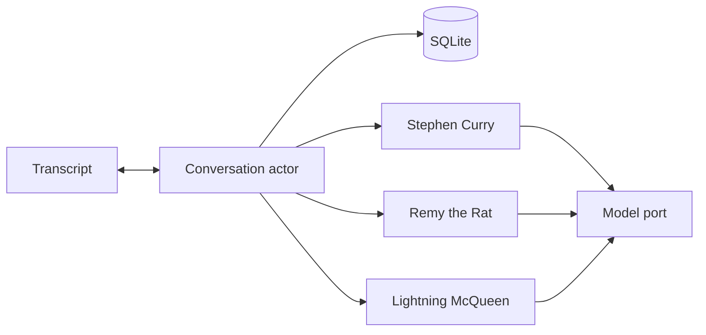
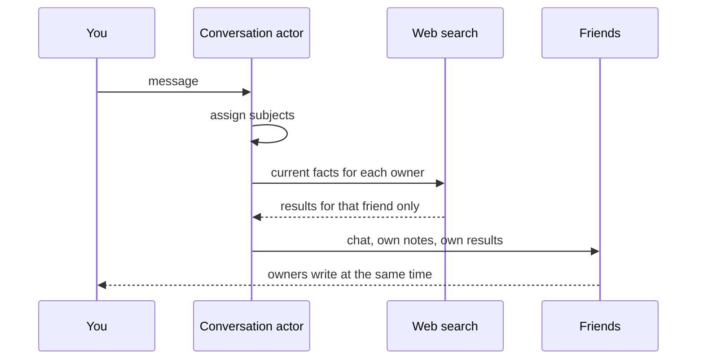
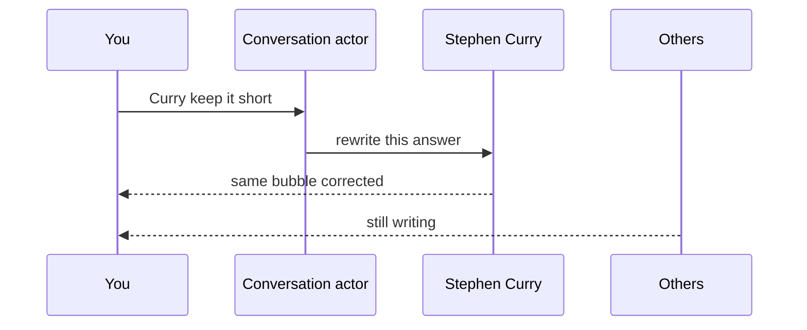

# Three Musketeers

Three Musketeers is a group chat with three friends. You talk to all of them in one conversation. Each has a personality and a subject they know well. They answer at the same time when they have something to say, they can reply to each other, and they stay quiet when they would only repeat someone else.

You can cut in while they are still writing. That changes the answer on screen. An instruction you give once stays for the rest of the chat, including after a reload.

## The friends

**Stephen Curry** knows sports. Teams, players, what is worth watching, how a season works. He wants you to love the game, and he will not invent a score.

**Remy the Rat** knows food and restaurants. What a place is good at, what to order, who it is for, what is worth the trip. He is picky, and he will not send you somewhere sloppy.

**Lightning McQueen** knows cars. What is fast, what is reliable, what it costs to own, whether a drive makes sense. He talks about whether a car can really do it, and he will not pretend a slow car is fast.

Each friend has private notes: who they are, how they judge their subject, and their general knowledge of that subject only. Curry's notes have no restaurants and no cars. Remy's have no sports and no cars. McQueen's have no sports and no restaurants. The notes are added only to that friend's model call. They never appear in the chat.

Every call also names the other friends and their subjects. It does not include their notes. The actor reads the question and assigns the subjects before anyone writes. A sports question is Curry's, food is Remy's, and cars are McQueen's, even if a friend asks to speak on the wrong subject. A question that crosses lanes needs each owner. "Should I take the job?" is nobody's subject, so only one friend answers.

They answer general questions in their subject. Well-known players, dishes, and cars are fair game. A live score, a current roster, today's price, or what is open comes from a web search run for that friend before they write. The results go only into that friend's call. If the search comes back empty, they still answer what they know and do not invent the missing current fact.

A friend speaks only as himself. He does not start a message with someone else's name. "Never mind" ends the turn. "Why can't you answer?" stays on the subject of the previous question.

## Architecture

The browser is one transcript. A conversation actor owns the room and is the only writer. Agents do not append to the log themselves. The app will use a DeepSeek model. It is an OpenAI-compatible stream, chosen with `MODEL_BASE_URL`, `MODEL_NAME`, and `MODEL_API_KEY`, so it can be switched to OpenAI, Anthropic, or another provider without a code change.

SQLite stores the messages, the standing instructions, and the three sets of private notes. The client receives names and the chat. It does not receive the private notes or the standing instructions.

One process owns a conversation. That single writer is what makes the order reliable.

## A turn

Your message is saved into the shared conversation. The actor assigns subjects from the message. Only the owner of each subject is allowed to write. Each owner still decides how long the answer should be. A friend is never added because he volunteered for someone else's subject.

When the question needs a current fact, the actor searches the web for that friend and puts the results in his call. On DeepSeek this uses the built-in web search. The chat does not show a search step.

Whoever is left starts writing at the same time, into the same chat.

When that wave finishes, a friend who was addressed by name may write one reply. Nobody else joins. A name counts as an address only when it is the first word, it is followed by a comma, or it comes right after "ask" or "tell". The names are Stephen, Curry, Remy, Lightning McQueen, and McQueen. The lowercase word "curry" is the dish, not Stephen Curry. The exchange ends when nobody has anything new, or after two rounds of replies. It does not start while a rewrite is still running.

Friends writing in the same wave cannot see each other's words as they appear, only the subject labels used to decide who stays. Two answers in one wave can still overlap in wording. The next round stays quiet about what was already said.

## Steering

A new line while friends are writing is handled before any more of the affected answer is accepted.

A name, using the same address rule as a reply, selects that friend. With no name, everyone currently writing is included. "Stop" halts all of them and cancels any further replies. Anything else rewrites the current answer in the same bubble. The other friends keep writing.

The old text stays on screen until the new answer produces its first word. If that call fails, or you say stop before then, the old text remains. The rewritten answer keeps its original place in the chat.

Your line is a normal message. A line that tells a friend how to behave is saved and put at the top of later calls, including after a reload. A line that asks a question or changes the topic changes this answer only. The actor marks each line keep or once. If that mark fails, a question mark means once, and "from now on", "always", "never", and "don't" mean keep. Anything else is once. "Stop" is neither. A kept line with a name is saved for that friend. A kept line with no name is saved for the room.

The bubble changes when the new words arrive. That is how the finished answer follows what you just said. How fast those words arrive is the model's time to first token.

## Effort

Effort is chosen in the private decision, before the first word. A light question gets a short answer because the writing that follows is held to that choice.

| Pick | The answer |
| --- | --- |
| Brief | One or two sentences |
| Normal | A short chat message |
| Thorough | As long as the question needs |

A friend who stays quiet never reaches this step. The choice is the model's judgment. A light question marked thorough can still run long.

## Order

The actor assigns a sequence number when a message is created. Each chunk is saved before it is sent. The page loads messages in that sequence. A rewrite does not change the number, so a reload shows the same conversation in the same order.

## What you see

A group chat. Messages appear as they are written. A steer changes the bubble that is already there. Nothing on screen names a mode, a vote, an effort level, or a redirect.
